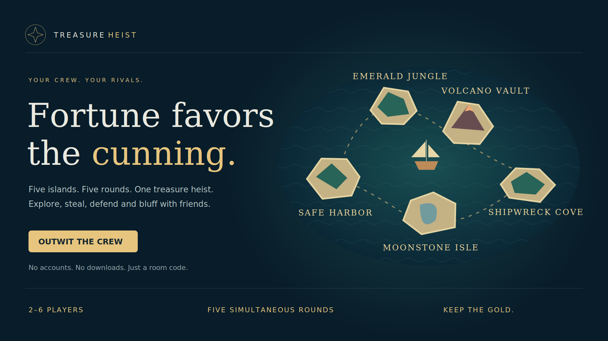
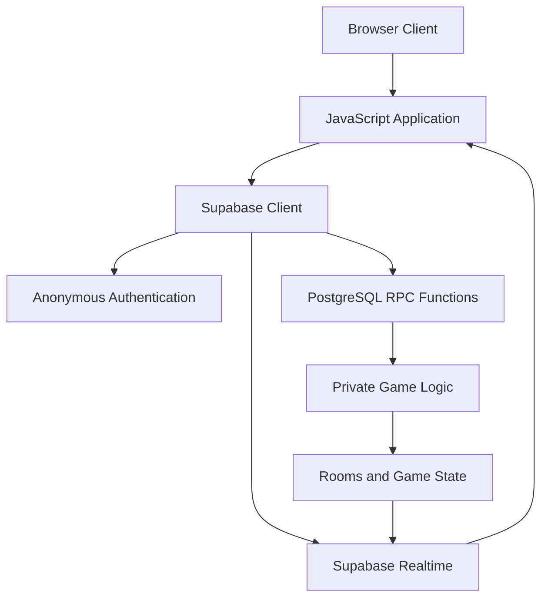

<p align="center">
  
</p>

<h1 align="center">TREASURE HEIST</h1>

<p align="center"><strong>Fortune Favors the Cunning</strong></p>

<p align="center">
  Five Islands. Five Rounds. One Treasure Heist.
</p>

<p align="center">
  <a href="https://treasure-heist-islands.dustyeft1.chatgpt.site"><strong>▶ PLAY THE LIVE GAME</strong></a>
  &nbsp; · &nbsp;
  <a href="https://github.com/Karthik1757/treasure-heist">GitHub Repository</a>
</p>

<p align="center">
  Multiplayer browser strategy game · 2–6 players · 5 rounds
</p>

---

## The Game

TREASURE HEIST is a multiplayer strategy game where players explore islands, collect treasure, read opponents, and decide when to protect or risk their gold.

Every round brings a choice: explore for treasure, steal from a rival, defend and bank your earnings, or bluff your way through the competition.

The objective is simple: finish with the greatest fortune.

## Gameplay

| Action | Description |
|---|---|
| **Explore** | Search an island for its hidden treasure. |
| **Steal** | Attempt to take treasure from another player. |
| **Defend & Bank** | Protect your position and secure your gold. |
| **Bluff** | Use deception and strategy to influence the round. |

### Five islands

| Island | Treasure |
|---|---:|
| Safe Harbor | 3 gold |
| Emerald Jungle | 2 or 6 gold |
| Volcano Vault | 0 or 8 gold |
| Shipwreck Cove | 1 or 7 gold |
| Moonstone Isle | 3 or 5 gold |

Treasure values and round events create uncertainty. Players must balance risk, timing, and strategy.

## Highlights

- Multiplayer rooms for 2–6 players.
- Five-round match progression.
- Five distinct treasure islands.
- Explore, Steal, Defend & Bank, and Bluff actions.
- Lobby readiness and host controls.
- Live room updates through Supabase Realtime.
- Persistent anonymous guest sessions.
- Server-side validation of game actions.
- Private action handling before round reveal.
- Reconnection and overdue-round recovery.
- Leaderboard, scoring, and rematch flow.

## Technology

| Layer | Technology |
|---|---|
| Frontend | HTML5, CSS3, JavaScript ES modules |
| Bundling | esbuild |
| Multiplayer backend | Supabase |
| Authentication | Supabase Anonymous Auth |
| Database | PostgreSQL |
| Live updates | Supabase Realtime |
| Game operations | PostgreSQL RPC functions |
| Testing | Node.js built-in test runner |

## Architecture



The browser handles presentation and player interaction. Supabase provides authentication, database operations, private game logic, and realtime room updates.

Game actions are submitted through database functions rather than direct browser-side writes to protected game state.

## Project Structure

```text
treasure-heist/
├── assets/
│   └── treasure-heist-cover.png
├── docs/
├── src/
│   ├── app.js
│   ├── client.js
│   ├── config.js
│   ├── game.js
│   ├── index.html
│   └── style.css
├── supabase/
│   └── migrations/
├── tests/
├── .env.example
├── .gitignore
├── build.mjs
├── CONTRIBUTING.md
├── LICENSE
├── package.json
└── README.md
```

## Run Locally

### Requirements

- Node.js 22 or later
- npm
- A Supabase project configured for this application

### 1. Clone the repository

```bash
git clone https://github.com/Karthik1757/treasure-heist.git
cd treasure-heist
```

### 2. Install dependencies

```bash
npm ci
```

### 3. Configure Supabase

Create a `.env` file in the project root using `.env.example` as the template.

Set:

```env
SUPABASE_URL=https://YOUR_PROJECT_REF.supabase.co
SUPABASE_PUBLIC_KEY=YOUR_SUPABASE_PUBLISHABLE_KEY
```

Use your own Supabase Project URL and publishable client key. Never put a service-role key or secret key in the browser application.

### 4. Configure the Supabase project

1. Create a separate Supabase project for development.
2. Apply the five SQL migration files in `supabase/migrations/` in ascending filename order.
3. Enable Anonymous Sign-ins in Supabase Authentication.
4. Ensure `public.room_snapshots` is included in the `supabase_realtime` publication.
5. Preserve the intended member-only read policy and protected database access.
6. Do not expose the private `heist_private` schema through the Data API.

### 5. Build

```bash
npm run build
```

The production-ready static application is generated in `dist/`.

### 6. Run unit tests

```bash
npm test
```

## Build and Test Commands

| Command | Purpose |
|---|---|
| `npm ci` | Install locked dependencies |
| `npm test` | Run offline unit tests |
| `npm run build` | Generate the static production bundle |
| `node tests/live.mjs` | Run the live integration test against an isolated development Supabase project |

The live integration test creates real anonymous users and game rooms. Use an isolated development project and review its fixtures before running it.

The live test is not a substitute for a production deployment review.

## Security

- Supabase client configuration is supplied through build-time environment variables.
- The browser application must use a publishable client key, never a service-role key.
- Game operations are validated through protected database functions.
- Hidden player actions are kept private until the appropriate reveal phase.
- Request receipts support safe retry handling.
- Room updates use Supabase Realtime.
- Local environment files and generated build output are excluded from Git.

## Deployment

The application builds as a static website.

1. Configure the required Supabase environment variables.
2. Run `npm ci`.
3. Run `npm run build`.
4. Publish the contents of `dist/` to a static HTTPS hosting provider.
5. Confirm the configured Supabase project and realtime settings.

No always-running application server or Supabase Edge Function is required by this architecture.

Publishing this GitHub repository does not deploy or modify the existing live game.

## Testing Notes

The repository includes offline unit tests and a separate live integration test.

A successful local build verifies the bundling process. It does not, by itself, verify a deployed Supabase environment, production security configuration, or every physical-device experience.

Historical test evidence is documented separately in `docs/`. Different test runs represent separate evidence sets and should not be added together as a single test count.

## License

This project is released under the MIT License. See [LICENSE](LICENSE).

Third-party dependencies retain their respective licenses.

---

<p align="center">
  <strong>TREASURE HEIST</strong><br>
  Fortune Favors the Cunning.
</p>
